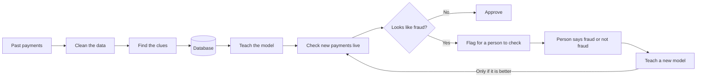

# How it works

This project is like a security guard for card payments. It looks at every payment as it happens, stops the ones that look like fraud, and gets better over time by learning from its mistakes.

## The short version

1. Download a big list of past card payments where we already know which ones were fraud.
2. Clean that data and work out clues that give fraud away.
3. Teach a computer model to spot fraud using those clues.
4. Send new payments through the model one by one, live. Suspicious ones get flagged.
5. People check the flagged payments and say "fraud" or "not fraud". The model learns from their answers and gets replaced only when a better version comes along.

## The big picture

## Step 1: Collect the data

We use a dataset of made-up but realistic card payments. Each payment says who paid, where, what kind of shop, how much, and when. Most importantly, it says whether the payment was fraud.

- Payments from **2019** (about 377,000) are used to teach the model.
- Payments from **2020** (about 556,000) are played back later as if they were happening right now.

Fewer than 1 in every 100 payments is fraud, which is what makes this hard.

Code: [fraud/download.py](../fraud/download.py)

## Step 2: Clean the data

Raw data is messy, so it goes through three stages, named like medals:

| Stage | What happens | Why |
|---|---|---|
| **Bronze** | Save an exact copy of the raw data | If something goes wrong later, we can always start again from the original |
| **Silver** | Fix the formats, tidy names, remove duplicates, and put broken rows (like a negative amount) aside in a "quarantine" table | Bad data gets set aside, not silently thrown away |
| **Gold** | Organise everything into neat tables of customers, shops and payments | Ready to be used by the model and the dashboard |

This is done with **PySpark**, a tool built for processing very large amounts of data quickly.

Code: [fraud/medallion.py](../fraud/medallion.py)

## Step 3: Find the clues

A single payment doesn't tell you much on its own. What gives fraud away is how it compares with the card's normal behaviour. For every payment we work out:

- **How busy the card is:** how many purchases it made in the last 24 hours
- **How fast:** how long since the card's previous purchase
- **How unusual the amount is:** compared with what this card normally spends
- **How far from home:** the distance between the cardholder's home and the shop
- **When:** the hour of the day and the day of the week
- **Who:** the cardholder's age and the type of shop

Fraud usually looks like a sudden burst of big, unusual purchases, often late at night.

## Step 4: Store everything

All the cleaned data goes into a **PostgreSQL** database. It also keeps track of:

- every payment the system has checked, and what it decided
- every "fraud / not fraud" answer that comes back
- every version of the model ever made

Code: [fraud/db.py](../fraud/db.py), [fraud/warehouse.py](../fraud/warehouse.py)

## Step 5: Teach the model

The model is called **gradient boosting**. Think of it as hundreds of small flowcharts of yes/no questions, like "Is the amount over $300? Is it after 10pm?" Each new flowchart fixes the mistakes of the ones before it.

- It learns from the **older** 2019 payments and is tested on the **newer** ones it has never seen. That's fair, because in real life you always predict the future using the past.
- For every payment it gives a **score from 0 to 1**. Close to 1 means "very likely fraud".
- Payments that score above a cut-off are **flagged**. The cut-off is chosen to catch as much fraud as possible without annoying too many honest customers.

Code: [fraud/model.py](../fraud/model.py)

## Step 6: Check payments live

The 2020 payments are played back at 20 per second, as if real customers were paying right now. For each one, the system works out the score, decides "approve" or "flag", and saves the result.

In real life you don't find out straight away whether a payment was fraud. Usually the customer reports it days later. To copy that, the true answer for each payment is kept hidden for 5 minutes and only then revealed.

Code: [fraud/stream.py](../fraud/stream.py)

## Step 7: People double-check

Flagged payments appear in the **Review** tab of the dashboard. A person looks at the clues and clicks **Fraud** or **Legit**. That answer is saved and later used to teach the model.

## Step 8: Learn from mistakes

When you press **Retrain** (or on a timer):

1. A **new model** is taught using the old data plus all the new answers. Payments the current model got wrong count 10 times as much, so it learns most from its mistakes.
2. The new model and the current one both take the **same test**, on the most recent payments the new model has never seen.
3. The new model only takes over if it **scores better**. If not, it's thrown out (but still written down, so you can see it tried).
4. The live checker notices the new model within about 10 seconds and starts using it, without stopping.

This "new model has to beat the old one first" setup is called **champion vs challenger**.

Code: [fraud/feedback.py](../fraud/feedback.py)

## Step 9: See it all on the dashboard

The dashboard is a web page that updates every 2 seconds.

| Tab | What it shows |
|---|---|
| **Live** | Payments coming in, how many got flagged, the latest payments and which shops get flagged most |
| **Review** | Flagged payments waiting for a person to check them |
| **History** | Fraud patterns in the 2019 data, for example by hour, amount and shop type |
| **Model** | How well the current model is doing, and every version that has been tried |

The buttons on the left let you filter by time, decision, shop type, state and amount.

Behind the page, a **FastAPI** server reads from the database and sends the numbers to the browser. Other programs can use the same server too, for example to ask "is this payment fraud?".

Code: [fraud/static/](../fraud/static/), [fraud/web.py](../fraud/web.py), [fraud/api.py](../fraud/api.py)

## Follow one payment

**A suspicious one:** someone spends $950 online at 11pm. It's the card's 7th purchase today, about 12 times what it normally spends, and 80 km from home.
The model gives it a score of **1.0**, so it's **flagged**. It shows up in the Review tab, a person clicks **Fraud**, and the next model learns from it.

**A normal one:** someone spends $12.50 at a grocery store at 2pm, 30 km from home.
The model gives it a score of **0.0**, so it's **approved** straight away.

## How good is it?

On payments it had never seen before:

- It gets **99.9%** of its decisions right.
- When it flags a payment, it's right about **93 times out of 100**.
- It catches about **86 out of every 100** frauds.

Why the last two matter most: almost every payment is honest, so a lazy model that approved everything would still be "right" 99.6% of the time while catching zero fraud.

## What's pretend and what's real

| Part | In this project | In a real bank |
|---|---|---|
| Payments | A realistic made-up dataset | Real customer payments |
| Live feed | 2020 payments played back | Payments arriving from card machines and websites |
| True answers | Revealed from the dataset after 5 minutes | Customers reporting fraud days or weeks later |

Everything else (cleaning the data, finding clues, testing models fairly, people in the loop, only upgrading to better models) works the way it would in a real system.

## Words you might not know

| Word | Meaning |
|---|---|
| **Model** | A program that learns patterns from examples and then makes guesses about new cases |
| **Feature / clue** | A piece of information the model uses to decide, like "purchases in the last 24 hours" |
| **Score** | How likely the model thinks a payment is fraud, from 0 to 1 |
| **Flagged** | Held back so a person can check it |
| **Precision** | Of the payments it flagged, how many were really fraud |
| **Recall** | Of all the real frauds, how many it caught |
| **PySpark** | A tool for processing huge amounts of data quickly |
| **PostgreSQL** | The database where everything is stored |
| **FastAPI** | The server that powers the dashboard and lets other programs talk to the system |
| **Champion vs challenger** | A new model has to beat the current one in a fair test before it replaces it |
